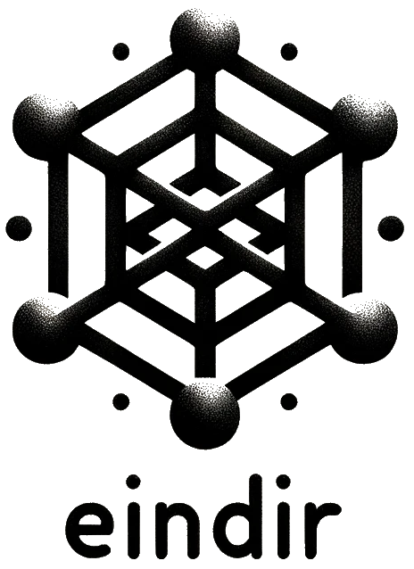

# eindir [](https://zenodo.org/doi/10.5281/zenodo.10672737)


A set of "particles" or components mainly focused on working with functions in ND.

## Development

The crate needs Rust 1.88 or newer (edition 2024).
The tests as CI runs them, with the Python steps in a virtualenv:

``` sh
cargo test --all-features
python -m pip install "maturin>=1.5,<2" pytest numpy
maturin develop --features python
pytest pytest/
```

With pixi, `pixi run test` runs the Rust tests and `pixi run -e python python-test` builds the extension and runs pytest.
Each change adds a `towncrier` fragment to `docs/newsfragments/`.
The version is set in `Cargo.toml` alone, and `tools/sync-version.sh` copies it to the other files.

## License
MIT

## Relation to anneal

eindir supplies the Objective trait, Bounds, low-discrepancy generators (Halton, etc.), GLE thermostat matrices, surrogate primitives (AdditiveSurrogate, Chebyshev, ReducedObjective), and an optional `autodiff` feature (`num-dual` forward mode).
These primitives let anneal and downstream codes stay inside the typed five-component algebra and share one implementation of each slot.

**User entry for optimization:** start with [anneal](https://github.com/HaoZeke/anneal) (`pip install anneal`), the budget-only `global_optimize` API, the notebook `examples/notebooks/01_quickstart.ipynb`, and https://anneal.rgoswami.me — not the eindir trait surface.

Project history: continuous development since **2023-02**.
Paper reproducibility: [anneal_repro](https://github.com/HaoZeke/anneal_repro), Zenodo [10.5281/zenodo.20672621](https://doi.org/10.5281/zenodo.20672621).

## Native compatibility contract

The C ABI exposes two complementary contracts for consumers such as rgpot and xtsci-optimize:

1. `eindir_core_abi_stamp()` reports the native handle layout.
   Consumers must require the same `abi_major`, `objective_layout`, `objective_size`, and `objective_align`.
   `abi_minor` and the DLPack minor version may be less than or equal to the consumer's supported value.
   Required feature bits must be a subset of the advertised `features`.
2. `eindir_objective_descriptor()` reports the semantic objective contract.
   `eindir_objective_descriptor_compatible(actual, required)` checks schema, producer, units, energy and gradient signs, operations, DLPack device and dtype, tensor layout, and callback lifetime.
   Zero scalar requirements and empty or NULL strings are wildcards, except `schema_id`, which must be set and equal on both sides.
   Operation bits are checked as a required subset.

`eindir_core_abi_stamp()` returns ABI major `1`, ABI minor `1`, objective layout `3`, DLPack `1.0`, and the gradient and batch feature bits.
The stable family string is `eindir.objective`.
Consumers should call the validation functions before the first objective evaluation and include the received `eindir_abi_stamp_t` or descriptor in a rejection diagnostic.
